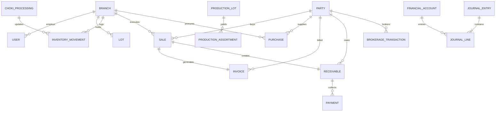

# Shreenathji Diamond Management ERP

> **Enterprise Diamond Manufacturing, Inventory & Financial Management System**  
> Operational Blueprint, Architecture Specification & Interactive React + TypeScript Showcase for Surat (Manufacturing Hub) and Mumbai (Bharat Diamond Bourse / Trading Hub).

[](https://nextjs.org/)
[](https://react.dev/)
[](https://www.typescriptlang.org/)
[](https://tailwindcss.com/)
[](LICENSE)

---

## 🌐 Interactive Product Showcase Website

This repository contains a full **Next.js 14 + TypeScript + Tailwind CSS** overview application designed for prospective diamond clients, factory managers, and traders to explore the system:
* **Simulated ERP Dashboard**: Multi-branch Surat & Mumbai live telemetry toggle.
* **Kapan Yield Simulator**: Interactive Kat weight, yield %, Ghat dust loss, and unit economics calculator.
* **5-Point Rough Reconciliation**: Interactive mass balance validator with worker audit log trails.
* **Commercial Trade Engine**: Rapaport Less %, Dalali (brokerage), and Vatav settlement calculator.
* **Database Architecture Viewer**: 34 relational tables across 9 domains with search and field filters.
* **Gujarati Industry Lexicon**: 13 authentic vernacular diamond trade concepts.

### Quick Start (Local Run)
```bash
npm install
npm run dev
# Open http://localhost:3000
```

### Vercel Deployment
Deployable on Vercel with **Zero Configuration** (Framework Preset: Next.js).

---

## 📄 Download Full Specification Document

* 📥 **[Download Shreenathji_Diamond_Management_System_Overview.docx](./Shreenathji_Diamond_Management_System_Overview.docx)**  
  *(Comprehensive Word document containing complete functional walkthroughs, Gujarati diamond trade lexicons, and domain-by-domain schema descriptions)*

---

## 🏛 Executive Overview

In the traditional diamond industry across Gujarat and Maharashtra, diamond cutting and trading houses often rely on fragmented spreadsheets. This leads to:
* **Carat Discrepancies**: Decimal rounding differences across rough procurement and finished stones.
* **Disconnected Branch Records**: Surat factory operations and Mumbai BDB sales offices operating on desynchronized ledgers.
* **Unreconciled Rough Inventory**: Difficulty in mathematically proving vault carats against cutting loss and rejection returns.
* **Mixed Partner Accounts**: Personal drawings (*Upad*) and capital deposits (*Jama*) mixed with everyday business operating expenses.

The **Shreenathji Diamond Management ERP** solves these operational challenges by unifying procurement, cutting, planning, polished sales, broker commissions, and double-entry financial accounting into one synchronized platform.

---

## 💎 What We Built (Core Functional Modules)

### 1. Dual-Branch Global Architecture
* **Surat Manufacturing Unit**: Centralizes raw rough diamond procurement, inventory vaults, Kapan production lots, worker labour wages, and local cash books.
* **Mumbai Trading Office (Bharat Diamond Bourse)**: Dedicated to polished diamond trading, commercial invoicing, customer receivables, and Dalali settlements.
* **Consolidated Multi-Branch View**: Provides executive leadership with a consolidated real-time overview of total carats, vault valuations, and combined financial statements.

### 2. Rough Diamond Procurement (કાચુ)
* **Lot Registration**: Logs incoming rough lots with carat weights tracked to 3 decimal places (`0.000` cts).
* **Multi-Currency Valuation**: Automatic conversion between USD per-carat rates and INR using verified daily exchange rates.
* **Credit Terms Tracking**: Tracks payment terms (30, 60, 90 days) with maturity alerts.

### 3. Inventory Vault & Traceability
* **Three Segregated Registers**: Real-time inventory tracking for:
  1. **Rough Diamonds (કાચુ)**
  2. **Princess Cut Polished (પ્રિન્સેસ)**
  3. **Choki (ચોકી)**
* **Immutable Audit Trail**: Every carat inflow, issue, transfer, yield, and sales dispatch is recorded in an audit ledger.
* **Vault Stock Adjustments**: Secure physical audit adjustments with required management justification.

### 4. Rough Stock Reconciliation (રફ મેળ)
* A mathematical proof of rough diamonds:
  $$\text{Available Rough} = \text{Opening Vault} + \text{Purchases} + \text{Rejection Recoveries}$$
  $$\text{Closing Vault Rough} = \text{Available Rough} - (\text{Manufacturing Kat} + \text{Rough Sales} + \text{Rejections})$$
* Guarantees zero unaccounted stone loss across factories.

### 5. Princess Cut Kapan Manufacturing (કાપન)
* **Production Lot Lifecycle**: Assigns rough diamonds to a tracked Kapan batch with initial Kat Weight (*કાટ વજન*).
* **Polished Yield %**: Calculates finished output carats (*તૈયાર વજન*) and yield percentages.
* **Cutting Ghat / Loss**: Tracks manufacturing loss and dust (*ઘાટ/ઘટ*) during sawing, shaping, and faceting.
* **Rejection Recovery**: Cleaved or flawed stones are separated and credited back to rough inventory at fair value.
* **Worker Wages (મજૂરી)**: Records cutter and polisher labour costs into the batch cost sheet.

### 6. Choki Processing (ચોકી)
* Specialized workflow for cleavage stones, side cuts, and re-cuttable diamonds.
* Direct Kat valuation without standard commercial trade discount factors.

### 7. Commercial Sales & Dalali (Brokerage) Engine
* **Commercial Invoices**: Generates GST and trade invoices applying the diamond industry's traditional "Less %" discount multiplier.
* **Dalali Engine**: Automatically calculates broker commissions, generates Dalali liabilities, and tracks broker payment clearances.
* **Receivables & Aging Analysis**: Automatically groups outstanding party payments into 5 aging brackets:
  * **Not Due**
  * **1–30 Days Overdue**
  * **31–60 Days Overdue**
  * **61–90 Days Overdue**
  * **90+ Days Overdue**
* **Payment Settlements**: Tracks partial or full payments, adjusting customer ledger balances in real time.

### 8. Financial Accounting & Double-Entry Ledgers
* **Partner Ledgers (ભાગીદાર ઉપાડ-જમા)**: Running accounts for business partners tracking drawings (*Upad*), capital deposits (*Jama*), and profit distributions.
* **Cash Books (રોકડ મેળ - આવક / જાવક)**: Branch-specific daily cash books recording all operational expenses and receipts.
* **Bank Books**: Reconciles RTGS, NEFT, and cheque payments against invoices and customer ledgers.
* **Automated Financial Statements**: Generates real-time Trial Balance, Profit & Loss (*નફો-નુકસાન*), and Balance Sheet (*સરવૈયું*).

### 9. User Experience & Adaptive Theming
* **Role-Based Portals**: Super Admin, Factory Manager, Sales Clerk, Procurement Clerk, and Cashier.
* **Workable Password Management**: In-app and login-screen password updates with secure hashing and instant session synchronization.
* **Dual High-Contrast Themes**:
  * **Black Theme**: Dark mode designed for diamond inspection and reduced glare.
  * **White-Green Theme**: Crisp white workspace with emerald green accents, high-contrast **black text**, and pure white text on green buttons.

---

## 📖 Gujarati Diamond Terminology Reference

| Gujarati Term | Transliteration | English Concept | Industry System Role |
| :--- | :--- | :--- | :--- |
| **કાચુ** | *Kachu* | Rough Diamonds | Raw uncut diamond lots procured in carats |
| **પ્રિન્સેસ** | *Princess* | Princess Cut | Square modified brilliant polished diamonds |
| **ચોકી** | *Choki* | Choki Cut | Cleaved stones, side cuts, or re-cuttable diamonds |
| **કાપન** | *Kapan* | Production Lot | Tracked manufacturing batch of rough stones |
| **કાટ વજન** | *Kat Vajan* | Input Kat Weight | Raw weight of rough diamond fed into production |
| **તૈયાર / પોલીસ** | *Taiyar / Polish* | Polished Yield | Net finished polished diamond carats obtained |
| **ઘાટ / ઘટ** | *Ghat* | Cutting Loss / Dust | Carat weight loss during sawing, shaping & polishing |
| **મજૂરી** | *Majuri* | Worker Wages | Labour wages paid per piece or per carat |
| **દલાલી** | *Dalali* | Brokerage | Commission payable to intermediaries on transactions |
| **ઉપાડ** | *Upad* | Drawings / Inward | Partner withdrawals or cash inward funding |
| **જમા** | *Jama* | Deposit / Outward | Customer payments or partner capital repayment |
| **આવક** | *Avak* | Cash Receipts | Daily cash inflows entered into the Cash Book |
| **જાવક** | *Javak* | Cash Outflows | Daily cash outflows for operational expenses or labour |

---

## 🗄 Database Architecture & Schema Blueprint

The underlying database consists of **34 normalized relational tables** categorized into **9 operational domains**:



### The 9 Database Domains

1. **Multi-Branch & Identity Domain**: `branches`, `users`, `user_sessions`
2. **Master Data Domain**: `parties` (suppliers, buyers, brokers), `partners`, `products` (Rough, Princess, Choki)
3. **Diamond Procurement Domain**: `purchases`, `purchase_items`
4. **Inventory & Lot Tracking Domain**: `lots`, `lot_assortments`, `inventory_movements`, `stock_adjustments`
5. **Princess Kapan Manufacturing Domain**: `production_lots`, `production_assortments`, `production_worker_wages`
6. **Choki Processing Domain**: `choki_processings`, `choki_movements`
7. **Sales & Brokerage Domain**: `sales`, `sale_items`, `invoices`, `brokerage_transactions`
8. **Receivables & Payments Domain**: `receivables`, `payments`
9. **Financial Accounting Domain**: `financial_accounts`, `journal_entries`, `journal_lines`, `cash_accounts`, `cash_transactions`, `bank_accounts`, `bank_transactions`, `partner_transactions`

---

## 📜 License

This documentation and specification is published under the [MIT License](LICENSE).

Copyright (c) 2026 Harsh Bhayani / Shreenathji Diamonds. All rights reserved.
